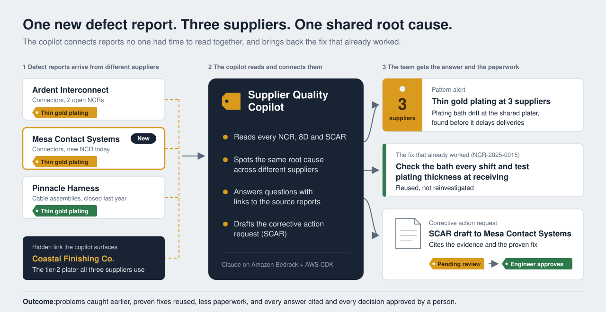
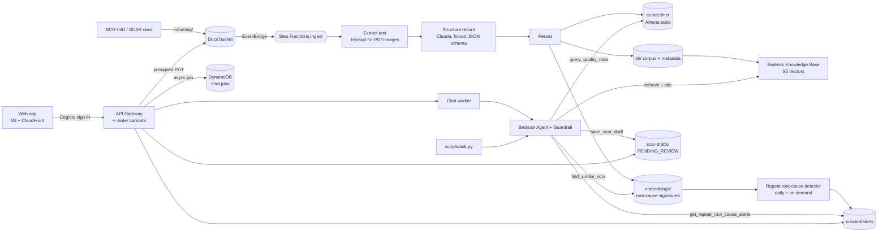

# Supplier Quality Copilot

A gen AI copilot for an aerospace and defense supply chain quality team, built on Amazon Bedrock with Python CDK. It reads nonconformance reports (NCRs), 8Ds and SCARs, turns them into structured data, spots **the same root cause showing up at different suppliers**, answers questions with citations, and drafts SCARs for human review.

> All suppliers, programs, parts and people in this repo are fictional. Deploy and destroy at will in your own AWS account.



## The business case in plain terms

**In one line:** the copilot helps a defense manufacturer's supplier quality team catch the same supplier problem showing up at several suppliers, and fix it faster using what already worked before.

### The problem

A defense company buys parts from hundreds of suppliers. When a part arrives defective, an engineer writes a nonconformance report (NCR). Those reports pile up as free text across suppliers and years, and no one has time to read them all. So:

- The same root cause can hit three different suppliers (for example, because they all use the same small plating shop), and each problem is handled separately. No one sees the pattern until it hurts delivery.
- A fix that worked a year ago is buried in an old report, so the team re-investigates from scratch.
- Writing corrective action requests to suppliers (SCARs) is slow, manual paperwork.

### What the copilot does

1. **Reads every report automatically.** Drop in an NCR and AI turns it into clean, searchable data: what failed, why, and at which supplier.
2. **Spots repeat problems across suppliers.** It flags when different suppliers share the same failure mechanism and explains why in plain English.
3. **Answers questions with evidence.** Engineers ask in plain language ("What worked last time?") and every answer links back to the source reports and shows how it was reached.
4. **Drafts the corrective action request.** An engineer reviews and approves it. Nothing goes to a supplier automatically.

### Why it matters

- **Problems are caught earlier**, before they turn into late deliveries.
- **Proven fixes are reused** instead of reinvented.
- **Engineers spend less time on paperwork** and more on engineering.
- **It's audit-friendly:** every answer is cited and every decision has a named approver, which matters in defense.

The demo shows it in one moment: a single new defect report arrives, and the copilot immediately connects it to two other suppliers and to a fix from last year that nobody remembered.

## Architecture



| Stack | What it creates |
|---|---|
| `SqcData` | Docs, lake and Athena results buckets; Glue database `supplier_quality` with `ncr`, `suppliers`, `alerts` tables; Athena workgroup |
| `SqcKnowledge` | S3 vector bucket and index; Bedrock Knowledge Base and S3 data source over `kb/` |
| `SqcIngest` | Step Functions pipeline (extract, structure, persist, sync KB) triggered by uploads to `incoming/` |
| `SqcAgent` | Bedrock Agent with 4 tools + knowledge base, Guardrail, agent alias `live`, detector Lambda on a daily schedule |
| `SqcApp` | Web app on S3 + CloudFront, Cognito user pool with managed login and a `reviewers` group, REST API (Cognito-authorized router Lambda), async chat worker with a DynamoDB jobs table, supplier risk brief Lambda |

### Why these choices

- **S3 Vectors** instead of OpenSearch Serverless keeps idle cost near zero and makes `cdk destroy` clean.
- **Root-cause signatures** (commodity + defect + root cause, no supplier or part) are embedded separately from the knowledge base, so the detector matches *failure mechanisms* across suppliers instead of matching documents that merely look alike.
- **Agent tools validate everything**: SQL must be a single `SELECT` over the three tables, the role can only read this database, and SCARs are only ever saved as drafts.
- **Guardrail** blocks prompt attacks, anonymizes PII, and denies requests for weapon system technical data.

## The demo storyline

The synthetic data (`data/seed`, 72 NCRs over 18 months) has two patterns built in:

1. **BGA solder voiding** at two PCBA suppliers after paste lot changes. Active from the start.
2. **Thin gold plating** on connector contacts. All three affected suppliers subcontract plating to the same tier-2 shop, *Coastal Finishing Co.* A closed 8D at SUP-0145 a year ago fixed it (per-shift bath titration plus XRF sampling). SUP-0107 has two open NCRs now.

`data/demo/NCR-2026-0039.txt` is a new NCR from **SUP-0112**. Uploading it live makes the plating problem span two active suppliers, and the detector raises a cross-supplier alert. That's the moment the demo is built around.

## Prerequisites

- AWS account with CDK bootstrapped (`cdk bootstrap`) in a Bedrock region (default `us-east-1`)
- Bedrock model access for the models in `cdk.json` (Claude Sonnet and Haiku via the `us.` cross-region inference profiles, Titan Text Embeddings V2)
- Python 3.12+, Node.js 20+ and the CDK CLI (`npm i -g aws-cdk`)

To use newer Claude models, change `agentModelId` / `extractionModelId` in `cdk.json` to the inference profile IDs listed in the Bedrock console.

## Deploy

```bash
python -m venv .venv && source .venv/bin/activate
pip install -r requirements-dev.txt
python -m pytest            # unit tests, no AWS needed
cdk synth
cdk deploy --all --require-approval never
```

## Load data and create your sign-in

```bash
python scripts/load_data.py seed     # ~5-10 min: 72 NCRs through the pipeline, then detector
```

Create a user for the web app and make them a SCAR reviewer (values come from the `SqcApp` stack outputs):

```bash
POOL=$(aws cloudformation describe-stacks --stack-name SqcApp \
  --query "Stacks[0].Outputs[?OutputKey=='UserPoolId'].OutputValue" --output text)
aws cognito-idp admin-create-user --user-pool-id $POOL --username you@example.com \
  --user-attributes Name=email,Value=you@example.com Name=email_verified,Value=true \
  --temporary-password 'TempPassw0rd!x' --message-action SUPPRESS
aws cognito-idp admin-add-user-to-group --user-pool-id $POOL --username you@example.com \
  --group-name reviewers
aws cloudformation describe-stacks --stack-name SqcApp \
  --query "Stacks[0].Outputs[?OutputKey=='WebUrl'].OutputValue" --output text
```

Open the `WebUrl`, sign in with the temporary password, and set a permanent one.

## The web app

| View | What it does |
|---|---|
| **Ask** | Chat with the copilot. Answers cite their NCRs (click one to open the record and source document), and *How I got this answer* lists every step: the SQL it ran, documents it searched, tools it called. |
| **Patterns** | Cross-supplier root-cause alerts with the generated explanation. *Run detector now* re-runs detection on demand. |
| **Suppliers** | A scorecard for every supplier (NCRs and critical NCRs over 90 days, open and overdue 8D responses, days to close, on-time 8D rate) with a rule-based risk tag and the reasons behind it. Each supplier has a monthly trend, Paretos of defects and root causes, its NCR list, and a one-click AI risk brief for the next supplier review. |
| **Upload NCR** | Drag in an NCR, 8D or SCAR and watch it move through reading, structuring, saving and indexing. |
| **SCAR review** | Drafts the copilot saved. Anyone can edit a pending draft; members of `reviewers` approve or reject it, with name, time and comment recorded. Nothing is sent to a supplier. |

Chat runs asynchronously (submit, then poll), so long multi-tool questions don't hit API Gateway's 29 second limit. The UI is plain HTML, CSS and JavaScript in `web/` with no build step and no third-party scripts; `cdk deploy` publishes it.

## How the supplier risk tag works

The tag is set by published rules, not by AI, so it can be audited. The highest level whose rule fires wins, and every triggered rule is shown as a reason. Thresholds live at the top of `lambdas/common/scorecard.py`.

| Tag | Any of these |
|---|---|
| **High risk** | Part of an active cross-supplier root-cause pattern; 2+ critical NCRs in the last 90 days; an open NCR with an overdue 8D response (more than 30 days); supplier on probation |
| **Watch** | 1 critical NCR in 90 days; 3+ NCRs in 90 days; the same defect code 3+ times in 12 months; average time to close above 45 days; on-time 8D responses below 80%; conditional approval |
| **Good standing** | None of the above |

The AI risk brief explains the tag for the next supplier review (top issues, whether corrective actions held, shared sub-tier risks, recommended actions), cites every claim to an NCR, and never changes the tag.

## Demo script

1. **Ask**: *"Which suppliers had the most critical NCRs in the last 90 days?"* Open *How I got this answer* to show the SQL.
2. **Patterns**: only BGA voiding is active.
3. **Upload NCR**: drop `data/demo/NCR-2026-0039.txt` (Mesa Contact Systems) and watch the pipeline.
4. **Patterns**: *Run detector now*. Thin gold plating appears across SUP-0107, SUP-0112 and SUP-0145.
5. *Ask about this pattern*: the answer cites the closed 8D at SUP-0145 that fixed it last year, and the shared tier-2 plater, Coastal Finishing Co.
6. *Draft a SCAR*, then **SCAR review**: edit if needed and approve.
7. **Suppliers**: Mesa Contact Systems is now *High risk* because it joined the plating pattern. Open it and click *Write risk brief* for a cited one-pager for the next supplier review.

To run the demo again, remove the uploaded NCR first: `python scripts/load_data.py reset-demo`. The terminal chat (`python scripts/ask.py`) still works and uses your AWS credentials directly.

Upgrading from Day 2? The synthetic NCRs now include 8D response and closure dates, so after `cdk deploy --all` run `python scripts/load_data.py seed` again (re-ingests the 72 NCRs) and then `python scripts/load_data.py reset-demo`.

To regenerate data for a different date: `python scripts/generate_synthetic_data.py --today 2026-11-01`.

## Calling the API directly

```bash
CLIENT=$(aws cloudformation describe-stacks --stack-name SqcApp \
  --query "Stacks[0].Outputs[?OutputKey=='UserPoolClientId'].OutputValue" --output text)
API=$(aws cloudformation describe-stacks --stack-name SqcApp \
  --query "Stacks[0].Outputs[?OutputKey=='ApiUrl'].OutputValue" --output text)
TOKEN=$(aws cognito-idp initiate-auth --client-id $CLIENT --auth-flow USER_PASSWORD_AUTH \
  --auth-parameters USERNAME=you@example.com,PASSWORD='<YourPassw0rd!x>' \
  --query AuthenticationResult.IdToken --output text)
curl -s -X POST "${API}chat" -H "Authorization: $TOKEN" -H "Content-Type: application/json" \
  -d '{"question": "Summarize open critical NCRs"}'          # -> {"jobId": ...}
curl -s "${API}chat/<jobId>" -H "Authorization: $TOKEN"       # poll until status is DONE
```

Routes: `GET /me`, `POST /chat`, `GET /chat/{jobId}`, `GET /alerts`, `POST /alerts/run`, `POST /uploads`, `GET /uploads/status?key=`, `GET /ncrs/{id}`, `GET /scars`, `GET|PUT /scars/item`, `POST /scars/decision`.

## Tuning the detector

The detector logs the distribution of cross-supplier similarities on every run. If it finds too many or too few patterns, try a different threshold without redeploying:

```bash
aws lambda invoke --function-name <DetectorFunctionName> \
  --cli-binary-format raw-in-base64-out \
  --payload '{"threshold": 0.72, "today": "2026-10-15"}' /dev/stdout
```

Then set `similarityThreshold` in `cdk.json` to make it permanent.

## Cost and teardown

Idle cost is close to zero: no clusters or always-on endpoints. You pay per Bedrock token, Athena query, Lambda and Step Functions run, and for small amounts of S3 and S3 Vectors storage. A full seed load plus a demo session typically costs a few dollars.

```bash
cdk destroy --all
```

All buckets, including the vector bucket, are removed with their contents.

## Toward production in a defense setting

- Deploy to **AWS GovCloud (US)** and confirm model availability there. Most of the IAM in this repo is partition-aware.
- Replace synthetic documents with QMS exports (e.g. NCR/SCAR records from the ERP or QMS) and connect supplier master data.
- Add KMS customer-managed keys, VPC endpoints, CloudTrail data events, and Bedrock model invocation logging.
- Keep the human approval step: SCARs and supplier communications stay drafts until an SQE signs them.

## Roadmap

- [x] Day 1: infrastructure, ingest pipeline, knowledge base, agent with tools, repeat root-cause detector, synthetic data
- [x] Day 2: web UI (chat with citations and agent steps, pattern inbox, NCR upload, SCAR review and approval), async chat
- [x] Day 3: supplier scorecards with a rule-based risk tag, trend and Pareto views, AI risk briefs
- [ ] Day 4: evaluation harness (golden questions, citation accuracy, extraction accuracy against generator ground truth)

## Repo layout

```
app.py, cdk.json         CDK app and settings (models, thresholds, schedule)
stacks/                  Data, Knowledge, Ingest, Agent, App stacks
lambdas/                 ingest/, agent_tools/, detector/, chat/ (worker), web/ (API), briefs/, common/
web/                     no-build web app (HTML, CSS, JS)
prompts/                 agent instruction
scripts/                 data generator, loader, terminal chat
data/seed, data/demo     generated synthetic corpus
tests/                   SQL guard, pattern storyline, scorecard rules, SCAR file and agent trace tests
```
