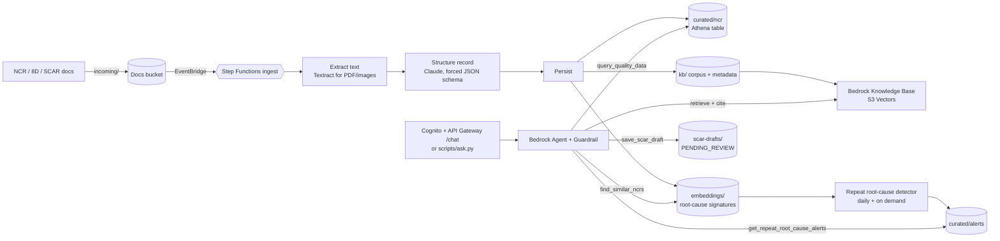

# Supplier Quality Copilot

A gen AI copilot for an aerospace and defense supply chain quality team, built on Amazon Bedrock with Python CDK. It reads nonconformance reports (NCRs), 8Ds and SCARs, turns them into structured data, spots **the same root cause showing up at different suppliers**, answers questions with citations, and drafts SCARs for human review.

> All suppliers, programs, parts and people in this repo are fictional. Deploy and destroy at will in your own AWS account.

## Architecture



| Stack | What it creates |
|---|---|
| `SqcData` | Docs, lake and Athena results buckets; Glue database `supplier_quality` with `ncr`, `suppliers`, `alerts` tables; Athena workgroup |
| `SqcKnowledge` | S3 vector bucket and index; Bedrock Knowledge Base and S3 data source over `kb/` |
| `SqcIngest` | Step Functions pipeline (extract, structure, persist, sync KB) triggered by uploads to `incoming/` |
| `SqcAgent` | Bedrock Agent with 4 tools + knowledge base, Guardrail, agent alias `live`, detector Lambda on a daily schedule |
| `SqcApp` | Cognito user pool, `POST /chat` REST API with Cognito authorizer |

### Why these choices

- **S3 Vectors** instead of OpenSearch Serverless keeps idle cost near zero and makes `cdk destroy` clean.
- **Root-cause signatures** (commodity + defect + root cause, no supplier or part) are embedded separately from the knowledge base, so the detector matches *failure mechanisms* across suppliers instead of matching documents that merely look alike.
- **Agent tools validate everything**: SQL must be a single `SELECT` over the three tables, the role can only read this database, and SCARs are only ever saved as drafts.
- **Guardrail** blocks prompt attacks, anonymizes PII, and denies requests for weapon system technical data.

## The demo storyline

The synthetic data (`data/seed`, 72 NCRs over 18 months) has two patterns built in:

1. **BGA solder voiding** at two PCBA suppliers after paste lot changes. Active from the start.
2. **Thin gold plating** on connector contacts. All three affected suppliers subcontract plating to the same tier-2 shop, *Coastal Finishing Co.* A closed 8D at SUP-0145 a year ago fixed it (per-shift bath titration plus XRF sampling). SUP-0107 has two open NCRs now.

`data/demo/NCR-2026-0039.txt` is a new NCR from **SUP-0112**. Uploading it live makes the plating problem span two active suppliers, and the detector raises a cross-supplier alert. That's the moment the demo is built around.

## Prerequisites

- AWS account with CDK bootstrapped (`cdk bootstrap`) in a Bedrock region (default `us-east-1`)
- Bedrock model access for the models in `cdk.json` (Claude Sonnet and Haiku via the `us.` cross-region inference profiles, Titan Text Embeddings V2)
- Python 3.12+, Node.js 20+ and the CDK CLI (`npm i -g aws-cdk`)

To use newer Claude models, change `agentModelId` / `extractionModelId` in `cdk.json` to the inference profile IDs listed in the Bedrock console.

## Deploy

```bash
python -m venv .venv && source .venv/bin/activate
pip install -r requirements-dev.txt
python -m pytest            # unit tests, no AWS needed
cdk synth
cdk deploy --all --require-approval never
```

## Load data and run the demo

```bash
python scripts/load_data.py seed     # ~5-10 min: 72 NCRs through the pipeline, then detector
python scripts/ask.py                # chat in your terminal
```

Suggested script:

1. *"Which suppliers had the most critical NCRs in the last 90 days?"* (Athena, structured)
2. *"Are there any repeat root causes across suppliers right now?"* (only BGA voiding)
3. Upload the new NCR: `python scripts/load_data.py demo`
4. Ask again. The gold plating pattern now appears across SUP-0107, SUP-0112 and SUP-0145.
5. *"What worked last time this happened, and which other suppliers use Coastal Finishing?"* (knowledge base, cites the closed 8D)
6. *"Draft a SCAR to Mesa Contact Systems for NCR-2026-0039 using the earlier fix as the expected corrective action."* (saved to `scar-drafts/` as PENDING_REVIEW)

To regenerate data for a different date: `python scripts/generate_synthetic_data.py --today 2026-11-01`.

## Calling the API

```bash
aws cognito-idp admin-create-user --user-pool-id <UserPoolId> --username you@example.com \
  --temporary-password 'TempPassw0rd!x' --message-action SUPPRESS
aws cognito-idp admin-set-user-password --user-pool-id <UserPoolId> --username you@example.com \
  --password '<YourPassw0rd!x>' --permanent
TOKEN=$(aws cognito-idp initiate-auth --client-id <UserPoolClientId> --auth-flow USER_PASSWORD_AUTH \
  --auth-parameters USERNAME=you@example.com,PASSWORD='<YourPassw0rd!x>' \
  --query AuthenticationResult.IdToken --output text)
curl -X POST "<ChatApiUrl>" -H "Authorization: $TOKEN" -H "Content-Type: application/json" \
  -d '{"question": "Summarize open critical NCRs"}'
```

API Gateway caps requests at 29 seconds; long multi-tool questions are better asked through `scripts/ask.py` until the UI moves to streaming.

## Tuning the detector

The detector logs the distribution of cross-supplier similarities on every run. If it finds too many or too few patterns, try a different threshold without redeploying:

```bash
aws lambda invoke --function-name <DetectorFunctionName> \
  --cli-binary-format raw-in-base64-out \
  --payload '{"threshold": 0.72, "today": "2026-10-15"}' /dev/stdout
```

Then set `similarityThreshold` in `cdk.json` to make it permanent.

## Cost and teardown

Idle cost is close to zero: no clusters or always-on endpoints. You pay per Bedrock token, Athena query, Lambda and Step Functions run, and for small amounts of S3 and S3 Vectors storage. A full seed load plus a demo session typically costs a few dollars.

```bash
cdk destroy --all
```

All buckets, including the vector bucket, are removed with their contents.

## Toward production in a defense setting

- Deploy to **AWS GovCloud (US)** and confirm model availability there. Most of the IAM in this repo is partition-aware.
- Replace synthetic documents with QMS exports (e.g. NCR/SCAR records from the ERP or QMS) and connect supplier master data.
- Add KMS customer-managed keys, VPC endpoints, CloudTrail data events, and Bedrock model invocation logging.
- Keep the human approval step: SCARs and supplier communications stay drafts until an SQE signs them.

## Roadmap

- [x] Day 1: infrastructure, ingest pipeline, knowledge base, agent with tools, repeat root-cause detector, synthetic data
- [ ] Day 2: web UI (chat with citations, alert inbox, SCAR draft review and approve)
- [ ] Day 3: supplier scorecards (trend and Pareto views) and supplier-specific risk briefs
- [ ] Day 4: evaluation harness (golden questions, citation accuracy, extraction accuracy against generator ground truth)

## Repo layout

```
app.py, cdk.json         CDK app and settings (models, thresholds, schedule)
stacks/                  Data, Knowledge, Ingest, Agent, App stacks
lambdas/                 ingest/, agent_tools/, detector/, chat/, common/
prompts/                 agent instruction
scripts/                 data generator, loader, terminal chat
data/seed, data/demo     generated synthetic corpus
tests/                   SQL guard and pattern storyline tests
```
